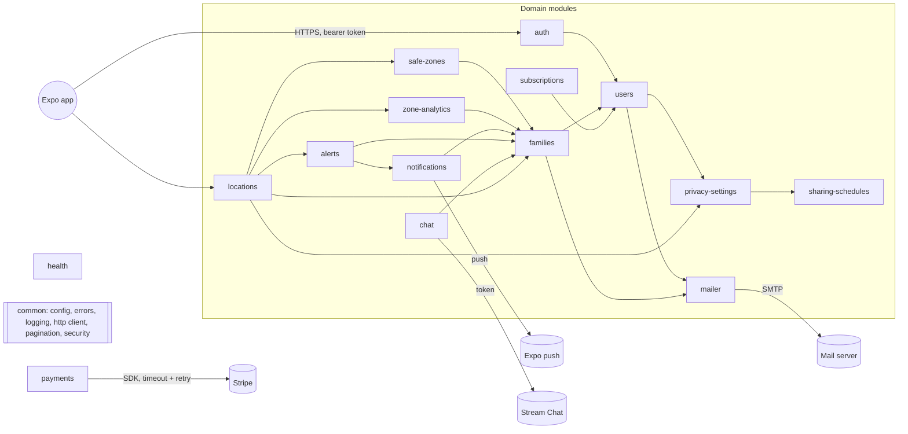
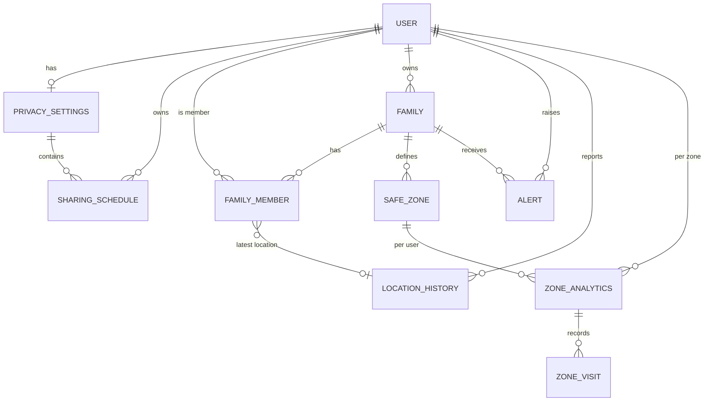

# Family Tracker API

Backend for a family location app. Members share their position with the people they choose, get alerts when someone enters or leaves a safe zone, and see how much time each person spends where. The companion Expo app lives in a separate repository.

## Features

- **Live locations** for a family, filtered by what each member allows (everyone, selected people, nobody) and by weekly sharing schedules, including overnight windows.
- **Safe zones** (circles on a map) with entry and exit detection, per-person visit history and time-per-day analytics.
- **Alerts**: zone entry/exit, low battery, emergency and heading-home, with Expo push notifications to the rest of the family.
- **Families and invites**: roles (admin, member), email invites with signed, expiring links, pending-invite handling.
- **Accounts**: registration, login, Google sign-in (verified server-side), token refresh, password reset, profile, account deletion, privacy settings.
- **Subscriptions and payments**: plan switch, Stripe payment intents behind one wrapped client.
- **Chat**: issues Stream Chat tokens and keeps the chat user list in sync with the family.

## Architecture

One Nest module per domain. Other modules only use what a module exports; `dependency-cruiser` fails CI on cycles and on imports that reach into another module.



A reported location flows through `locations`: visibility is resolved from the user's privacy settings and schedules, the point is stored, the member's last position is updated, zone entry and exit are computed (pure geometry in `safe-zones/domain`), visits are recorded and alerts raised and pushed.

### Data model



### Folder layout

```
src/
  common/        config (zod), errors, http client, logging, pagination, security
  <domain>/      users, auth, families, locations, safe-zones, zone-analytics, sharing-schedules,
                 privacy-settings, alerts, notifications, chat, payments, subscriptions, mailer, health
    dto/  entities/  domain/ (pure rules + unit tests)  *.controller.ts  *.service.ts  *.module.ts  index.ts
  database/      migrations/, data-source.ts (TypeORM CLI), seed/
  bootstrap/     HTTP setup shared with tests, Swagger, OpenAPI generator
test/            e2e tests against a real PostgreSQL
scripts/         db.mjs (local Postgres), smoke.sh, compare-shapes.mjs
docs/            openapi.json
```

## Stack

NestJS 11, TypeORM, PostgreSQL, zod (configuration), class-validator, pino (nestjs-pino), helmet, `@nestjs/throttler`, `@nestjs/terminus`, Stripe, Stream Chat, Nodemailer, Jest and supertest.

## Run locally

Needs Node 22 or newer. No Docker required.

```bash
npm ci
cp envs/.env.example envs/.env.local     # then fill in the secrets (any 16+ character strings work locally)
npm run db:up -- --seed                  # starts PostgreSQL on 127.0.0.1:54320, migrates, loads demo data
npm run start:dev                        # http://localhost:3000, Swagger UI at /
```

`db:up` is idempotent. `npm run db:down` stops the database, `npm run db:reset` stops it and deletes `.pgdata/`. The default `DATABASE_URL` in `envs/.env.example` matches it. Docker is still an option: `docker-compose.yml` starts Postgres 15 (copy `.env.example` to `.env` first).

### Demo data

`npm run seed` (also `db:up -- --seed`) creates ten fictional people in three families around public landmarks of Zagreb, fourteen days of movement, zone visits, alerts, privacy settings, a sharing schedule and every subscription state (free, active, expired, canceled). It does nothing when the demo users exist; `npm run seed:reset` replaces them, and it refuses to run with `NODE_ENV=production`.

All demo accounts share the password `DemoPass123!`, for example `demo.owner@example.com` (premium admin of the "Horvat family"), `demo.teen@example.com` (shares only with selected people and has a school-hours schedule) and `demo.sara@example.com` (no family). Chat messages live in Stream Chat, so they are not part of the seed.

## Tests

```bash
npm run typecheck
npm run lint
npm run deps:check          # architecture rules
npm test                    # unit tests: domain rules, config, errors, http client, tokens, guard
npm run test:cov            # with coverage
npm run test:e2e            # supertest against real PostgreSQL (starts and stops the embedded server)
scripts/smoke.sh            # boots the built app on a seeded database and walks the main flows over HTTP
```

The e2e suite covers registration and login, invites and roles, zone entry and exit with analytics and alerts, privacy visibility, pagination, subscriptions, schedules, validation and error bodies, rate limiting, health probes, and applying all migrations to an empty database.

## Configuration

Validated with zod at startup; the process exits with a list of problems if anything is missing. No other file reads `process.env`.

| Variable | Required | Default | Purpose |
| --- | --- | --- | --- |
| `DATABASE_URL` | one of | | Postgres connection string |
| `DATABASE_HOST`, `_PORT`, `_USERNAME`, `_PASSWORD`, `_NAME` | one of | port `5432` | Alternative to the URL |
| `DATABASE_DISABLE_SSL` | no | `false` | `true` for local databases |
| `DATABASE_POOL_SIZE` | no | `10` | Connection pool size |
| `DATABASE_STATEMENT_TIMEOUT_MS` | no | `15000` | Per-statement timeout |
| `SESSION_SECRET`, `JWT_SECRET`, `JWT_MAIL_SECRET` | yes | | At least 16 characters each |
| `MAIL_HOST`, `MAIL_USER`, `MAIL_PASS`, `MAIL_FROM` | yes | | SMTP account (`MAIL_PORT`, default `465`) |
| `STRIPE_SECRET_KEY` | yes | | Stripe API key |
| `STREAM_API_KEY`, `STREAM_API_SECRET` | yes | | Stream Chat credentials |
| `GOOGLE_CLIENT_IDS` | no | disabled | Comma-separated OAuth client ids accepted for `POST /auth/google` |
| `CORS_ORIGINS` | no | none | Comma-separated browser origins (native apps send no Origin) |
| `PORT` | no | `3000` | HTTP port |
| `LOG_LEVEL` | no | `info` | pino level |
| `NODE_ENV` | no | `development` | |

## Database and migrations

Schema changes are versioned files in `src/database/migrations`; the app never alters the schema itself.

```bash
npm run migration:run                                         # apply
npm run migration:generate -- src/database/migrations/Name    # diff entities against the database
npm run migration:revert                                      # undo the last one
npm run migration:run:prod                                    # compiled output, for deploys
```

Run migrations before the new version takes traffic.

## API

- Swagger UI at `/` when the server runs; the generated spec is committed as [`docs/openapi.json`](docs/openapi.json) (`npm run openapi` regenerates it, CI checks it is current).
- Every route needs a bearer token except login, Google sign-in, registration, password reset and health. Tokens last 30 days; `POST /auth/refresh` renews a valid one.
- Create endpoints for families, safe zones and alerts honour an optional `Idempotency-Key` header (replays within 24 hours return the first response).
- Errors: `{ "code": "FAMILY_NOT_FOUND", "message": "...", "details": [...], "requestId": "..." }` (plus the legacy `statusCode` and `error`). Send `X-Request-Id` to correlate; it is echoed back and logged.
- Lists accept `limit` (max 1000) and `cursor`; the next cursor is in the `X-Next-Cursor` header.
- Probes: `GET /health` (legacy), `/health/live`, `/health/ready` (database; turns 503 as soon as shutdown starts).

## Out of scope

- **OpenTelemetry tracing and metrics:** one process and one database; pino request logs with a request id answer the questions that come up. Add an exporter when there is a second service to trace across.
- **Transactional outbox:** the only side effects of a write are best-effort push notifications; there is no broker, so there is no dual write to make atomic.
- **Job queue and retention job:** nothing runs in the background; the idempotency table is purged on write and the location history grows slowly.
- **Separate database roles and migration lint (squawk):** worth doing for a hosted deployment; the project ships one role.

## Screenshots

Mobile screenshots live in the app repository. Placeholders: `docs/screenshots/map.png`, `docs/screenshots/zones.png`, `docs/screenshots/alerts.png`.

## License

MIT, see [LICENSE](LICENSE).
